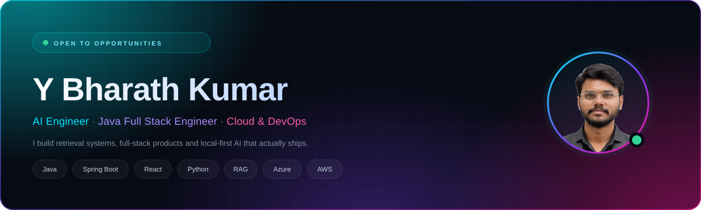
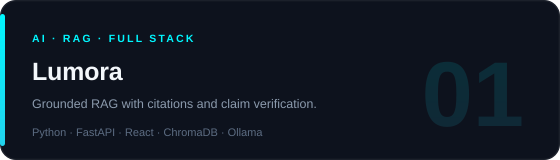
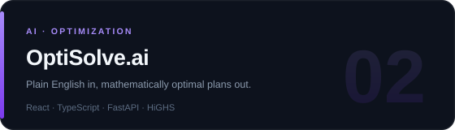
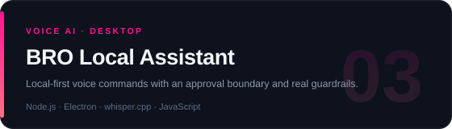
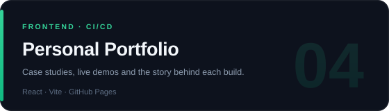
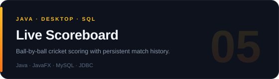
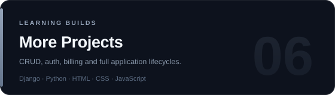

  

 

   

 

  

---

## 🧠 About Me

I build **AI products end-to-end** — the retrieval and reasoning layer, the API behind it, and the interface people actually use. I like problems where the answer has to be *provably right*, not just plausible.

My base is **Java + Spring Boot** and **React**, and lately most of my time goes into **LLM systems**: RAG pipelines, local inference, voice interfaces, and the guardrails that keep them trustworthy.

- 🤖 **AI Engineering** — RAG, embeddings, vector retrieval, relevance gating, citation grounding
- ☕ **Full Stack** — Spring Boot and FastAPI services, React + Vite front ends
- ☁️ **Cloud & DevOps** — Azure, AWS, Docker, Linux, GitHub Actions, release automation
- 🛡️ **Engineering hygiene** — test coverage, allowlists, approval boundaries, observable systems

---

## 🛠️ Tech Stack

<b>AI · LLM · RAG</b>

     

  

<b>Languages &amp; Frameworks</b>

  

<b>Cloud &amp; DevOps</b>

  

<b>Databases &amp; Tools</b>

---

## 🚀 Featured Projects

<table>
<tr>

<td width="50%" valign="top">
  
  

     
  

</td>

<td width="50%" valign="top">
  
  

     
  

</td>

</tr>
<tr>

<td width="50%" valign="top">
  
  

    
  

</td>

<td width="50%" valign="top">
  
  

     
  

</td>

</tr>
<tr>

<td width="50%" valign="top">
  
  

    
  

</td>

<td width="50%" valign="top">
  
  

    
  

</td>

</tr>
</table>

---

## 💼 Experience

<table>
<tr>

<td width="50%" valign="top">

<h3>🤖 AI Quality Data Analyst Intern</h3>
<b>IBM</b> · 12 weeks

<ul>
  <li>Assessed AI model performance and flagged inconsistencies in training data</li>
  <li>Worked with cross-functional teams to improve dataset quality and evaluation criteria</li>
  <li>Learned where model behaviour actually breaks down in production</li>
</ul>

</td>

<td width="50%" valign="top">

<h3>🛡️ Cyber Security Intern</h3>
<b>IBM SkillsBuild</b> · 6 weeks

<ul>
  <li>Explored threat models, vulnerability assessment and core encryption techniques</li>
  <li>Built a steganography project that hides messages inside images</li>
  <li>Learned to reason about security boundaries before shipping features</li>
</ul>

</td>

</tr>
</table>

---

## 📜 Certifications

  

 

 

---

## 📊 GitHub Analytics

 

 

---

## 🌐 Let's Connect

Open to <b>AI Engineer</b>, <b>Java Full Stack</b> and <b>Cloud &amp; DevOps</b> roles — and always up for a conversation about retrieval, agents or backend architecture.

  

   

---

  

